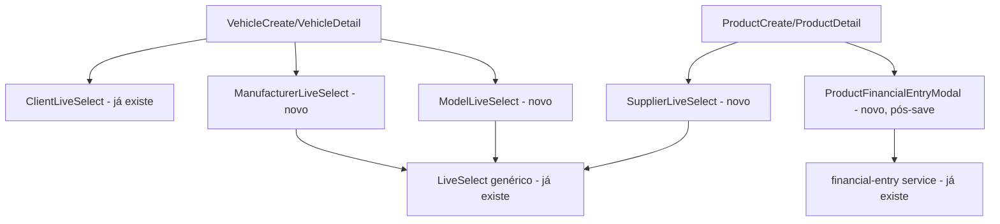

# Cliente/Veículo/Fornecedor/Produto UX Design

**Spec**: `.specs/features/client-vehicle-supplier-product-ux/spec.md`
**Status**: Draft

---

## Architecture Overview

Majoritariamente ajustes de fluxo/estilo em cima do que já existe (sem componente novo), mais três frentes que introduzem coisa nova: (1) três novos composite selects seguindo exatamente o padrão `LiveSelect` + modal de cadastro rápido já estabelecido pela feature `live-select` (`ManufacturerLiveSelect`, `ModelLiveSelect`, `SupplierLiveSelect`); (2) um modal novo pós-save de Produto perguntando sobre saída financeira; (3) duas mudanças pequenas de backend (campo `Service.cost_price` e uma flag `is_business_mirror` em `Supplier`).



---

## Code Reuse Analysis

### Existing Components to Leverage

| Component | Location | How to Use |
| --- | --- | --- |
| `LiveSelect` | `src/modules/core/components/LiveSelect.jsx` (feature `live-select`) | Base de `ManufacturerLiveSelect`/`ModelLiveSelect`/`SupplierLiveSelect` — mesmo contrato. |
| `ClientLiveSelect` | `src/modules/client/components/ClientLiveSelect.jsx` (feature `live-select`) | Reaproveitado tal como está no campo Cliente de Veículo — zero mudança nele. |
| `Modal.jsx` | `src/modules/core/components/Modal.jsx` | Casca dos novos modais de cadastro rápido (Marca/Modelo/Fornecedor) e do `ProductFinancialEntryModal`. |
| `WhatsAppButton`/`whatsappLink` | `src/modules/core/components/WhatsAppButton.jsx`, `src/modules/core/utils/whatsapp.js` | Reaproveitados sem alteração em Fornecedor e Produto — só muda onde são chamados e o texto da mensagem. |
| `RelatedDataCard` | `src/modules/core/components/RelatedDataCard.jsx` | Já suporta `renderItem` (usado em `ClientDetail.jsx` pros veículos) — só falta passar esse prop nas chamadas de `SupplierDetail.jsx` que hoje usam o default sem link. |
| `FinancialEntryService.create` (ou equivalente já usado por `useFinancialEntryForm`) | `src/modules/financial-entry/services/financial-entry.js` | Reaproveitado sem endpoint novo pro `ProductFinancialEntryModal`. |
| `datalist` de sugestão (padrão do campo Cor) | `src/modules/vehicle/pages/VehicleCreate.jsx:120-126` | Mesmo padrão aplicado ao campo Unidade de Medida de Produto. |

### Integration Points

| System | Integration Method |
| --- | --- |
| `ManufacturerService`/`ModelService`/`SupplierService` (create) | Mesmas chamadas já usadas pelas telas de cadastro completo. |
| `Service` (backend) | Migration nova adicionando `cost_price` nullable, mesmo padrão de `Product.cost_price`. |
| `Supplier` (backend) | Migration nova adicionando `is_business_mirror` (boolean, default `False`), com data migration setando `True` pro fornecedor-espelho já existente de cada `Business` (match por CNPJ, uma vez) + `business_service.create()` passa a marcar `True` na criação do espelho daqui pra frente. |

---

## Components

### `ManufacturerLiveSelect` / `ModelLiveSelect`

- **Purpose**: Composite de busca+cadastro rápido pra Marca/Modelo, mesmo padrão de `ClientLiveSelect`.
- **Location**: `src/modules/vehicle/components/ManufacturerLiveSelect.jsx`, `ModelLiveSelect.jsx`
- **Interfaces**: `<ManufacturerLiveSelect value onChange error />`; `<ModelLiveSelect value onChange manufacturerId error disabled disabledHint />` (igual ao `VehicleLiveSelect`, `ModelLiveSelect` fica desabilitado sem `manufacturerId`).
- **Dependencies**: `LiveSelect`, `useManufacturerOptions`/`useModelOptionsByManufacturer` (já existentes).
- **Reuses**: Modal de cadastro rápido só com campo "Nome" (Marca) ou "Marca" (pré-preenchida, travada) + "Nome" (Modelo) — cadastro trivial, sem cascata adicional.

### `SupplierLiveSelect`

- **Purpose**: Composite de busca+cadastro rápido pra Fornecedor, usado em Produto/Serviço.
- **Location**: `src/modules/supplier/components/SupplierLiveSelect.jsx`
- **Interfaces**: `<SupplierLiveSelect value onChange error />`.
- **Dependencies**: `LiveSelect`, `useSupplierOptions`.
- **Reuses**: campos mínimos do cadastro completo de Fornecedor (razão social/nome fantasia, CNPJ, telefone) num modal — mesma análise de "campos obrigatórios" que `ClientQuickCreateModal` já fez, aplicada ao schema de Fornecedor.
- **Ordenação**: a lista de opções recebida (`useSupplierOptions`) é reordenada no composite pra colocar o fornecedor com `is_business_mirror=true` primeiro, antes de aplicar o filtro de texto.

### `ProductFinancialEntryModal`

- **Purpose**: Modal pós-save de Produto perguntando se quer registrar a saída financeira correspondente.
- **Location**: `src/modules/product/components/ProductFinancialEntryModal.jsx`
- **Interfaces**: `<ProductFinancialEntryModal open product onClose onConfirm />` — `product` traz `cost_price`/quantidade inicial pra sugerir o valor.
- **Dependencies**: `Modal`, serviço de criação de `FinancialEntry` já existente.
- **Reuses**: `useResourceForm`'s `onSuccess` callback (sem alteração na própria `useResourceForm`) — `ProductCreate.jsx` passa `onSuccess: (product) => setShowFinancialModal(product)` em vez de só navegar.

---

## Data Models

### `Service` (migration nova)

```python
cost_price = models.DecimalField(
    "Preço de Custo", max_digits=10, decimal_places=2, null=True, blank=True
)
```

**Relationships**: nenhuma mudança — campo solto, mesmo padrão de `Product.cost_price`.

### `Supplier` (migration nova)

```python
is_business_mirror = models.BooleanField(
    "É o próprio estabelecimento", default=False
)
```

**Relationships**: nenhuma mudança estrutural — só uma flag. Data migration associada marca `True` nos registros já existentes que batem por CNPJ com o `Business` dono; `business_service.create()` passa a marcar na criação do espelho.

---

## Error Handling Strategy

| Error Scenario | Handling | User Impact |
| --- | --- | --- |
| Falha ao criar `FinancialEntry` no modal pós-save do Produto | Erro aparece dentro do modal (toast ou inline), produto já foi salvo com sucesso antes — não desfaz o produto | Produto fica salvo mesmo se a saída financeira falhar; usuário pode tentar de novo ou lançar manualmente depois |
| Fornecedor/Marca/Modelo sem match no filtro | Mesmo comportamento já definido em `live-select` (atalho de criar aparece) | Consistente com o resto do sistema |

---

## Risks & Concerns

| Concern | Location (file:line) | Impact | Mitigation |
| --- | --- | --- | --- |
| Card "Abrir Orçamento"/"Abrir OS" em Veículo não tem pesquisa de embasamento suficiente (nem um placeholder existe hoje, diferente de Cliente) | spec.md, Assumptions | Risco de a Task ficar subdimensionada — pode precisar de endpoint novo (buscar orçamentos/OS por veículo) que não foi confirmado existir | Marcado como P3 com confirmação pendente — Tasks não detalha esse item até uma pesquisa adicional confirmar o que o backend já expõe (`/veiculos/<id>/orcamentos/` existe? precisa criar?). |
| `is_business_mirror` — migration de dados por match de CNPJ pode falhar silenciosamente se algum `Business` tiver CNPJ divergente do seu próprio fornecedor-espelho (dado sujo) | `apps/businesses/services/business_service.py:53-76` | Fornecedor-espelho de algum negócio antigo pode não ficar marcado, e não aparecer primeiro na lista | Data migration loga/lista quaisquer `Business` sem match em vez de falhar silenciosamente — vira item de conferência manual, não quebra a migration. |
| `ExportReportButton`/`PdfIconButton` não são tocados por esta feature mas aparecem perto de itens relacionados (ex. relatórios) — confirmar que nenhuma mudança de label aqui conflita com o bloco 3 (que mexe em "gerar relatórios" na OS) | n/a | Duplicação de trabalho entre features se não alinhado | Nenhuma ação deste bloco toca nomenclatura de relatório — fica só no bloco 3. |

---

## Tech Decisions

| Decision | Choice | Rationale |
| --- | --- | --- |
| Como identificar o fornecedor-espelho | Flag `is_business_mirror` nova, não heurística de CNPJ no frontend | Mais explícito, mais barato de consultar, não duplica regra de negócio no frontend |
| Marca/Modelo ganham `LiveSelect` igual Cliente/Veículo | Sim, mesmo padrão | Já é um catálogo (não precisa de busca-no-servidor), consistente com a decisão já tomada na feature `live-select` |
| `ProductFinancialEntryModal` dispara via `onSuccess`, não `redirectTo` | `onSuccess` | É exatamente o caso de uso que esse parâmetro do `useResourceForm` já foi feito pra cobrir — nenhuma mudança na infraestrutura de formulário |
