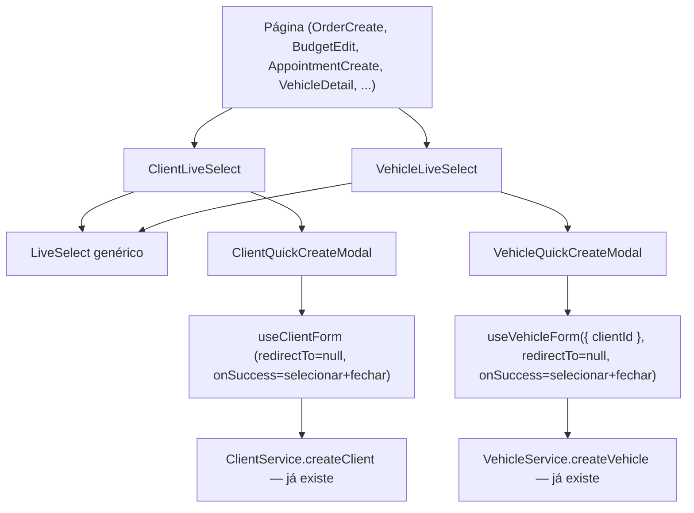

# Live Select (Cliente/Veículo) Design

**Spec**: `.specs/features/live-select/spec.md`
**Status**: Draft

---

## Architecture Overview

Três camadas: (1) um primitivo genérico de busca+seleção (`LiveSelect`), sem nenhum conhecimento de cliente/veículo; (2) um componente composto por entidade (`ClientLiveSelect`, `VehicleLiveSelect`) que junta o primitivo com o modal de cadastro rápido daquela entidade; (3) as 8 páginas existentes trocam o `SelectField` de Cliente/Veículo pelo composto correspondente — zero mudança de backend, zero schema novo (os formulários de cadastro completo de Cliente/Veículo já têm todo o required/optional certo).

### Approach Exploration

| Abordagem                                                                                                                    | Descrição                                                                                                                                                                 | Trade-off                                                                                                                                                                                                                                            |
| ---------------------------------------------------------------------------------------------------------------------------- | ------------------------------------------------------------------------------------------------------------------------------------------------------------------------- | ---------------------------------------------------------------------------------------------------------------------------------------------------------------------------------------------------------------------------------------------------- |
| **A — Primitivo genérico + composto por entidade (escolhida)**                                                               | `LiveSelect` não sabe nada de cliente/veículo; cada entidade ganha um componente composto pequeno (`ClientLiveSelect`/`VehicleLiveSelect`) que junta o primitivo + modal. | Mais um arquivo por entidade, mas cada peça faz uma coisa só (bate com "componente pequeno, se faz 3+ coisas, separa"); P2 (Produto/Serviço/Fornecedor) vira só mais um composto reaproveitando o mesmo `LiveSelect`.                                |
| B — Estender o `FilterSelect` existente pra ter busca+criação                                                                | Reaproveita o Listbox já estilizado em vez de criar componente novo.                                                                                                      | `FilterSelect` é usado hoje só em popover de filtro de listagem (lista pequena e estática, ex. status) — misturar esse uso com "campo de formulário que linka registro" arrisca regredir os filtros existentes e confunde o propósito do componente. |
| C — Um `EntitySelect` monolítico com um enum de tipo (`"client"`\|`"vehicle"`) que ramifica a lógica dentro de um arquivo só | Um componente só, menos arquivos.                                                                                                                                         | Cresce um `switch`/`if` por tipo de entidade dentro do mesmo componente — fica pior a cada novo tipo (Produto/Serviço/Fornecedor no P2), mais difícil de testar cada entidade isolada.                                                               |

**Escolhida: A.** Reaproveita o máximo de código já existente (hooks de formulário, schemas, `Modal.jsx`) e deixa o caminho livre pra P2 sem reescrever nada desta feature.

---

## Code Reuse Analysis

### Existing Components to Leverage

| Component                                                                                         | Location                                                                                                            | How to Use                                                                                                                                                                                    |
| ------------------------------------------------------------------------------------------------- | ------------------------------------------------------------------------------------------------------------------- | --------------------------------------------------------------------------------------------------------------------------------------------------------------------------------------------- |
| `useClientForm`                                                                                   | `src/modules/client/hooks/useClientForm.js`                                                                         | Ganha parâmetros opcionais `redirectTo`/`onSuccess` com default = comportamento atual (preserva a tela cheia de cadastro); o modal passa `redirectTo: null` + `onSuccess` próprio.            |
| `useVehicleForm({ clientId })`                                                                    | `src/modules/vehicle/hooks/useVehicleForm.js`                                                                       | Já aceita `clientId` pré-preenchido — só precisa dos mesmos overrides `redirectTo`/`onSuccess` que `useClientForm`.                                                                           |
| `clientSchema`/`clientDefaults`/`toClientPayload`                                                 | `src/modules/client/domain/schema.js`                                                                               | Usados **sem alteração nenhuma** — todos os campos que o modal esconde (endereço, complemento, etc.) já são opcionais no schema, então um subconjunto de campos renderizados já valida certo. |
| `vehicleSchema`/`vehicleDefaults`                                                                 | `src/modules/vehicle/domain/schema.js`                                                                              | Idem — só `color`/`mileage` são opcionais, e já ficam de fora do modal por decisão da spec.                                                                                                   |
| `Modal.jsx`                                                                                       | `src/modules/core/components/Modal.jsx`                                                                             | Casca genérica do modal — portal, fecha em Escape/overlay/X, slot de `footer`. Usado tal como está.                                                                                           |
| `SelectField`/campos de formulário existentes (estado→cidade em cascata, marca→modelo em cascata) | `src/modules/client/pages/ClientCreate.jsx`, `src/modules/vehicle/pages/VehicleCreate.jsx`                          | O conteúdo interno dos modais reusa os MESMOS campos/cascatas já implementados nessas páginas — não inventa nenhuma lógica de estado→cidade ou marca→modelo nova.                             |
| `@headlessui/react` (`Combobox`/`ComboboxInput`/`ComboboxOptions`/`ComboboxOption`)               | já é dependência (`^2.2.10`, confirmado em `package.json`), já usado neste repo via `Listbox` em `FilterSelect.jsx` | `LiveSelect` usa o `Combobox` da mesma lib — nenhuma dependência nova.                                                                                                                        |

### Integration Points

| System                                                        | Integration Method                                                                                                       |
| ------------------------------------------------------------- | ------------------------------------------------------------------------------------------------------------------------ |
| `ClientService.createClient` / `VehicleService.createVehicle` | Mesmas chamadas de API já usadas pelas páginas de cadastro completo — o modal não inventa endpoint novo.                 |
| TanStack Query (`clientKeys.all`, `vehicleKeys.all`)          | Mesma invalidação de cache que o cadastro completo já faz, pra lista de opções atualizar sozinha depois do quick-create. |

---

## Components

### `LiveSelect`

- **Purpose**: Select genérico com busca-ao-digitar e um slot de "nada encontrado, cadastrar novo" — não sabe nada sobre cliente/veículo.
- **Location**: `src/modules/core/components/LiveSelect.jsx`
- **Interfaces**:
  - `<LiveSelect label value onChange options getSearchText? error disabled disabledHint createLabel onCreateNew? />` — mesmo contrato de `SelectField` (`options: [{id, name}]`, `value` string, `onChange(value)`) mais:
  - `getSearchText(option): string` — opcional; default usa `option.name`. Cliente passa um que concatena nome+documento; Veículo passa um que concatena placa+marca+modelo.
  - `onCreateNew(): void` — opcional; se ausente, não mostra o atalho de cadastro (deixa `LiveSelect` reaproveitável em contexto sem criação, ex. filtro).
- **Dependencies**: `@headlessui/react` `Combobox`.
- **Reuses**: paleta/classes Tailwind de `FilterSelect.jsx` (`input-premium`, `label-premium`, cores de foco) pra manter visual idêntico ao resto do sistema.

### `ClientLiveSelect`

- **Purpose**: Composto pronto pra usar no lugar do `SelectField` de Cliente — junta `LiveSelect` + `ClientQuickCreateModal`.
- **Location**: `src/modules/client/components/ClientLiveSelect.jsx`
- **Interfaces**: `<ClientLiveSelect label value onChange error disabled />` (options vêm de `useClientOptions()` internamente — página não precisa mais chamar o hook pra esse campo).
- **Dependencies**: `useClientOptions`, `LiveSelect`, `ClientQuickCreateModal`.
- **Reuses**: nada de novo além do já listado acima.

### `ClientQuickCreateModal`

- **Purpose**: Modal com os campos mínimos de cliente (tipo PF/PJ, nome+sobrenome+CPF ou razão social+CNPJ, estado, cidade, telefone).
- **Location**: `src/modules/client/components/ClientQuickCreateModal.jsx`
- **Interfaces**: `<ClientQuickCreateModal open onClose onCreated={(client) => void} />`.
- **Dependencies**: `Modal`, `useClientForm` (com overrides), campos de formulário já usados em `ClientCreate.jsx` (subconjunto).
- **Reuses**: `clientSchema`/`clientDefaults`/`toClientPayload`, cascata estado→cidade já implementada em `ClientCreate.jsx`.

### `VehicleLiveSelect`

- **Purpose**: Composto pronto pra usar no lugar do `SelectField` de Veículo.
- **Location**: `src/modules/vehicle/components/VehicleLiveSelect.jsx`
- **Interfaces**: `<VehicleLiveSelect label value onChange clientId error disabled disabledHint />` — filtra as opções pelo `clientId` recebido (mesma lógica `.filter()` já usada em cada página hoje, só que centralizada aqui em vez de repetida 4x); se `clientId` vazio, desabilita o campo e mostra `disabledHint` (ex. "Escolha um cliente primeiro") em vez do atalho de criação.
- **Dependencies**: `useVehicleOptions`, `LiveSelect`, `VehicleQuickCreateModal`.
- **Reuses**: mesma lógica de filtro client-side por `client_id` que já existe em `OrderCreate.jsx`/`BudgetCreate.jsx`/etc., só que move pra dentro do componente em vez de repetida em cada página.

### `VehicleQuickCreateModal`

- **Purpose**: Modal com os campos mínimos de veículo (cliente pré-preenchido e travado, marca→modelo em cascata, ano, ano modelo, placa, combustível).
- **Location**: `src/modules/vehicle/components/VehicleQuickCreateModal.jsx`
- **Interfaces**: `<VehicleQuickCreateModal open onClose onCreated={(vehicle) => void} clientId />`.
- **Dependencies**: `Modal`, `useVehicleForm({ clientId })` (com overrides), cascata marca→modelo já usada em `VehicleCreate.jsx`.
- **Reuses**: `vehicleSchema`/`vehicleDefaults`, `useManufacturerOptions`/`useModelOptionsByManufacturer`.

---

## Data Models

Nenhum — feature 100% frontend, usa os models/endpoints de Client e Vehicle que já existem, sem campo novo.

---

## Error Handling Strategy

| Error Scenario                                                             | Handling                                                                                                                                                                                                              | User Impact                                                              |
| -------------------------------------------------------------------------- | --------------------------------------------------------------------------------------------------------------------------------------------------------------------------------------------------------------------- | ------------------------------------------------------------------------ |
| Validação falha no modal (campo obrigatório vazio, CPF/CNPJ mal formatado) | `useClientForm`/`useVehicleForm` já resolvem isso via `zodResolver` — erro aparece embaixo do campo, mesmo padrão das páginas de cadastro completo.                                                                   | Vê a mensagem de erro no campo, modal continua aberto.                   |
| Backend rejeita (ex. CPF duplicado)                                        | `parseApiError` já mapeia erro de campo do DRF pra `form.setError` — mesmo caminho que o cadastro completo já usa, sem código novo.                                                                                   | Vê a mensagem de erro do backend no campo certo, modal continua aberto.  |
| Usuário fecha o modal sem salvar                                           | `onClose` simplesmente desmonta/esconde o modal — nenhum estado do formulário-pai é tocado.                                                                                                                           | Campo volta a ficar vazio (ou no valor anterior), resto da tela intacto. |
| `VehicleQuickCreateModal` aberto sem `clientId`                            | Não deveria acontecer — `VehicleLiveSelect` já desabilita o atalho de criação quando `clientId` está vazio (AC9 do spec). Defensivamente, o modal recusa abrir e loga um aviso se chamado sem `clientId` mesmo assim. | Não vê a opção de criar veículo até escolher/criar um cliente primeiro.  |

---

## Risks & Concerns

| Concern                                                                                                                                                   | Location (file:line)                                                                                                                                             | Impact                                                                                                                                            | Mitigation                                                                                                                                                                                                                             |
| --------------------------------------------------------------------------------------------------------------------------------------------------------- | ---------------------------------------------------------------------------------------------------------------------------------------------------------------- | ------------------------------------------------------------------------------------------------------------------------------------------------- | -------------------------------------------------------------------------------------------------------------------------------------------------------------------------------------------------------------------------------------- |
| API do Headless UI `Combobox` (v2) tem estrutura de sub-componentes diferente do `Listbox` já usado em `FilterSelect.jsx`                                 | `FilterSelect.jsx:1` (só Listbox, nenhum Combobox no repo ainda)                                                                                                 | Risco de inconsistência visual/comportamental se não seguir a documentação oficial do v2 à risca                                                  | Tasks inclui conferir a doc oficial do Headless UI v2 pro `Combobox` antes de implementar `LiveSelect`, e replicar as classes Tailwind (`input-premium`, `label-premium`, cores de foco) do `FilterSelect` pra manter visual idêntico. |
| "Limpar veículo ao trocar cliente" precisa ser fiada em CADA uma das 4 páginas (Order/Budget/Appointment ×2, Vehicle não se aplica) — fácil esquecer uma  | `OrderCreate.jsx`, `OrderEdit.jsx`, `BudgetCreate.jsx`, `BudgetEdit.jsx`, `AppointmentCreate.jsx`, `AppointmentDetail.jsx` (6 páginas com os dois campos juntos) | Uma página esquecida permite salvar veículo de outro cliente sem perceber                                                                         | Tasks lista essa regra como item explícito de "Done when" em CADA uma das 6 páginas, não uma vez só.                                                                                                                                   |
| `useClientForm`/`useVehicleForm` ganham parâmetros novos (`redirectTo`/`onSuccess` override) — risco de regressão no fluxo de cadastro completo existente | `src/modules/client/hooks/useClientForm.js:7-18`, `src/modules/vehicle/hooks/useVehicleForm.js:7-22`                                                             | Se o default mudar sem querer, `ClientCreate.jsx`/`VehicleCreate.jsx` (cadastro completo) param de redirecionar pra listagem depois de salvar     | Os novos parâmetros têm default = comportamento atual exato (`redirectTo = "/clientes"` etc.) — só o modal passa override explícito. Teste de regressão dos testes já existentes de `ClientCreate`/`VehicleCreate` cobre isso.         |
| Nenhuma cobertura de teste hoje pra "modal cria registro dentro de outro formulário" — padrão novo no repo                                                | confirmado por pesquisa: nenhum precedente existente                                                                                                             | Tasks adiciona testes novos pros 2 modais e pro `LiveSelect` isolado — não há teste espelho pra copiar, escreve do zero a partir dos ACs do spec. |

> Nenhum risco de segurança/performance identificado — feature não introduz chamada de API nova nem dado sensível novo.

---

## Tech Decisions

| Decision                                                                                            | Choice                                                                 | Rationale                                                                                                                                                                     |
| --------------------------------------------------------------------------------------------------- | ---------------------------------------------------------------------- | ----------------------------------------------------------------------------------------------------------------------------------------------------------------------------- |
| Primitivo de busca                                                                                  | Headless UI `Combobox` (não um input+dropdown feito à mão)             | Já é dependência, já usado neste repo (via `Listbox`), lida com teclado/acessibilidade/posicionamento sem reescrever do zero.                                                 |
| Fonte do filtro                                                                                     | Client-side sobre `useClientOptions`/`useVehicleOptions` já existentes | Decidido em Discuss — zero mudança de backend nesta feature.                                                                                                                  |
| Onde mora a regra "limpar veículo ao trocar cliente"                                                | Na página (parent), não dentro de `VehicleLiveSelect`                  | `VehicleLiveSelect` não é dono do campo Cliente — a página é quem tem os dois campos e decide a relação entre eles, mesmo padrão que o `.filter()` client-side já segue hoje. |
| Reaproveitar `clientSchema`/`vehicleSchema` inteiros no modal, em vez de criar um schema "reduzido" | Reaproveitar os schemas completos                                      | Todos os campos escondidos no modal já são opcionais nos dois lados (back+front) — um schema novo seria duplicação sem necessidade.                                           |

> **Project-level decision candidate:** A dupla "primitivo genérico (`LiveSelect`) + composto por entidade" é um padrão que o P2 desta mesma iniciativa (Produto/Serviço/Fornecedor) vai replicar — vale registrar como AD-NNN no `STATE.md` deste repo quando o P2 começar, não antes (ainda não é um padrão comprovado em produção).
